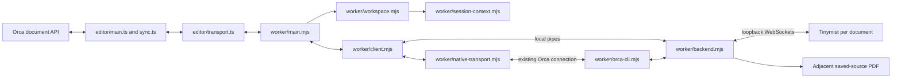

# Typst Preview

Last updated on 2026-11-17 at commit `04246d0`.

Open a `.typ` file in Orca and select **Preview** beside **Source**. Edit the
source beside Tinymist's live rendering; drag the divider to resize. Paste the
full `.typ` path from Orca's tab header into **Full file path** and press Enter
or **Open preview**. Alternatively, choose the file from the list, newest
modification first.
The plugin suggests the current workspace and compiles the chosen file on its
host through the existing Orca connection.
Saving updates a PDF beside the `.typ` source while Preview is open.

**Reading view** hides the source and fills the editor with the preview.
**Split view** restores the source and the divider's previous position, keeping
the same draft and compiler. Resizing retains the current reading position.
**Fit width** resets manual zoom to the preview's available width. These controls
change display only; they do not change paper size, pagination or source content.
Handbook index, section and return links jump immediately to their destination
near the top of the viewport. Clicking them does not also reveal source. The
separate **Reveal cursor** button retains Tinymist's source-position navigation.

Requires Orca desktop 1.4.247 or newer, Tinymist on the
workspace host, and Node.js 22+ on remote hosts. Local compilation uses Orca's
bundled Node runtime. The renderer is pinned to Tinymist's 2026-11-03 build
(Typst 0.15.1). This plugin targets the Orca desktop app; browser-only clients are unsupported.

## Install from GitHub and receive updates

Add `https://github.com/yukiumi13/orca-typst-preview.git` with ref `main` under
**Settings > Plugins > Plugin settings > Catalog sources**, then install **Typst Preview** from
that source. Its catalog identity is `yukiumi13.typst-preview`. Approve the
initial installation and keep **Update plugins automatically** enabled.
Disable the old `local.typst-preview` folder installation to avoid duplicate
Preview editors. Transfer any custom executable, font or package settings once.
The plugin settings button is beside **Add plugin**. Choose **Catalog sources**
there; **Add plugin > From a Git URL** expects a root `orca-plugin.json` and does
not install this catalog repository. For a downloaded source archive, the
installable folder is its `plugin/` subdirectory.

Each catalog release pins the built `plugin/` directory to a commit and content
hash. Updates from the same repository without added access keep their approval.
Orca 1.4.247 checks at startup and every six hours, waiting twelve hours after
first seeing a non-official release before installing it automatically. Refresh
the catalog and click **Update** to install sooner. The source repository and
catalog are public; no GitHub sign-in is needed to fetch them.

## Folder installation

The installable artifact is the **whole `dist/` folder**. Copy it to the machine
running the Orca desktop app. On **Orca 1.4.247**, install or update that folder
through the plugin settings page's local-folder action. This version does not
provide the `orca plugin install` CLI command. Complete any approval Orca shows.
The local identity is `local.typst-preview`; publication is not required.

On newer Orca versions that provide `plugin install`, the equivalent command is:

```sh
orca plugin install /absolute/path/to/typst-preview --json
```

The CLI prints any required approval command with `--approve <fingerprint>`.
On Linux outside an Orca terminal, the app executable is generally `orca-ide`
(bare `orca` can be the unrelated GNOME screen reader).

The trusted worker runs Node code with the user's account access. It launches
Tinymist and reuses the same app's runtime client to create, send to, read and
close its own background terminals on remote hosts. Declared host API capabilities are
workspace reading and its own settings. The 1.4.248-only `terminal:read` host
capability is not needed for this transport. Existing Orca connections and
saved paired environments provide host routing; no independent SSH connection
is opened. The owning profile is resolved from the plugin registry, including
content-addressed release directories. Installing only on a headless server
does not add a desktop view.

There are no Project folders or SSH host settings. The optional settings are:

| Setting | Behavior |
| --- | --- |
| Tinymist executable | Uses `tinymist`; searches PATH and common user install locations. An explicit path supports `~/`. |
| Node.js executable on workspace host | Defaults to `node`; an absolute path can resolve a remote shell PATH issue. |
| Additional font directories | Passes a font path to the compiler on the workspace host. |
| Local package directory | Optional override; default Typst package discovery normally finds `@local` packages. |
| Export PDF beside source | Enabled by default; exports saved source while its preview is open. |

The manifest omits the `frame` restriction introduced in Orca 1.4.248 so
1.4.247 can use its default desktop editor frame.

Close and reopen Preview after changing settings. A failed or empty workspace
lookup reports the underlying discovery error and can be retried with Preview;
the chosen workspace and file stay fixed for the editor frame. Closing and
reopening Preview in that frame reuses the selection. Click the filename to
choose again; click the workspace name to correct the suggested workspace.
Pasting a path also selects its nearest listed workspace on the same host,
so the suggested workspace need not be correct. Paths with spaces and matching
outer single/double quotes are accepted. Relative paths, URLs and paths outside
the listed workspaces are refused. A failed open leaves the old binding intact.

Orca 1.4.247 recreates custom editor frames when switching file tabs, while
reusing the same public `PanelCaller.id` for different documents. Every preview
page therefore generates its own random instance nonce and sends it with all
worker requests. Workspace bindings, choice lists, startup guards and view
ownership use the native caller plus this nonce. These
selections are held only in the frame and must be supplied again after that
recreation. Its document API supplies content and versions, but no path or
stable document id. Global workspace focus and identical content do not identify
a tab. Neither shared plugin local storage nor guest session storage identifies
the returning host tab. The plugin does not restore another frame's choice.

## Follow a preview

1. `editor/main.ts` immediately requests `preview.workspace`. Before remote
   lookups, `worker/session-context.mjs` captures the owning desktop profile's
   current workspace id, execution host and active file metadata. It uses the
   installed Orca app's read-only profile reader for `workspaceSession` and
   `workspaceSessionsByHostId`, read together from SQLite or the legacy JSON.
   Global focus selects the workspace; its remote file records come from the
   corresponding host partition. When 1.4.247 leaves the host stamp null,
   one unambiguous active-file owner supplies it. Partition-local focus never
   overrides global focus; an explicitly local file uses exact-id lookup.
   The worker resolves that exact id on its owning host. This avoids
   name/branch matching for installed desktops, including older public APIs
   that omit remote workspace ids. This is a workspace suggestion, not proof
   that the editor document belongs to it: global focus can be stale, and an
   editor can open a file outside the focused workspace.
2. `worker/client.mjs` starts a local helper or a helper inside an Orca-owned
   remote terminal. The worker transmits the bundled backend in memory; no
   backend installation or port forwarding is required on the remote host.
3. `preview.files` lists `.typ` paths and filesystem modification times in
   **that workspace**, without reading file contents or hashing them. The
   menu shows the workspace's full path, relative filenames and modification
   times in US Eastern time. The owner selects the file open in the editor;
   compilation never starts from a same-content guess. Files changed by agents
   are included in this ordering; unsaved keystrokes are not. This is filesystem
   modification time, not the note's `updated:` field or a user edit history.
   A wrong workspace can be corrected through the workspace button: the worker
   lists only the already captured host and accepts an exact listed id. This
   correction does not change the Orca source document or contact other hosts.
   `preview.openPath` instead resolves the pasted absolute path against that
   host's listed workspaces, then checks the canonical file inside its root on
   the compilation host. It installs the new frame binding only after opening
   succeeds; no workspace dropdown interaction is required for this route.
4. The helper launches one Tinymist preview per canonical source path. The
   workspace directory is the Typst root; relative imports, fonts and local
   packages resolve on that host. Unsaved buffers go to Tinymist's memory-file
   protocol. The plugin never writes the `.typ` source itself.
5. Saved source changes trigger `tinymist compile` to a temporary sibling PDF.
   Successful output replaces `<source-name>.pdf` atomically, after checking
   the source still matches. Compilation errors retain the previous PDF.
   The toolbar shows PDF success or error; hover for the path or diagnostic.

Within a surviving frame, the selected workspace/path stays fixed when global
focus changes. A remounted frame has a fresh selection.
A file must be saved at least once before previewing. Listing uses Git's
tracked/unignored file list in repositories, with a directory scan for non-Git
folders. Both exclude files escaping the workspace and files over 8 MiB.
Git-ignored files are excluded from the list; an explicitly pasted path can open
one inside a listed workspace. Large scans stop at 2,000 files or the response
limit; the menu reports that the returned subset is incomplete. File-list logs
separate helper startup from metadata lookup round-trip time, including remote
transport. The older content-discovery backend RPC remains for diagnostic probes;
the editor no longer invokes it or automatically opens a content match.

The adjacent PDF represents **saved source**; the live preview includes unsaved
edits. Export runs on opening Preview and changes to the main `.typ` file.
Dependency-only changes update Tinymist's live preview; save the main file or
reopen Preview to refresh its PDF. Export stops when the last preview closes.

## Runtime flow and lifecycle

This collaboration diagram shows API calls and data transport:



The desktop session reader is a compatibility bridge verified against Orca
1.4.247 and 1.4.253; it uses that installed app's own reader and never writes profile data.
When that bridge is unavailable, the public workspace API can still resolve an
exact workspace id. Names and branches alone cannot identify a workspace when
that API omits paired hosts. Unresolved identity returns a diagnostic for retry.
The plugin never enumerates saved servers or their worktrees to infer focus;
only the captured host is contacted, so an unrelated offline machine cannot
block preview. An error from the document's actual host still prevents compilation.

Workspace correction closes this frame's preview first and only accepts choices
from its host's current list. The source buffer stays attached to the original
Orca tab: this is a binding chooser, not navigation to a different source file.

The worker owns workspace bindings, view leases and bounded event queues. The
backend owns compiler processes and sockets. Different documents receive OS
allocated control/data ports bound to `127.0.0.1`. Multiple views of one file in
one workspace share a compiler; their memory overlay follows the most recent
buffer update. The isolated editor accesses rendering through Orca RPC instead
of connecting directly to compiler ports.

Remote traffic uses gzip-compressed JSON in sequenced base64 frames, complete-line
markers and bounded acknowledgement windows. Bootstrap code is compressed too;
decompressed messages are limited to 16 MiB. Frames stay below Orca's partial
terminal line limit. The installed plugin loads the owning app's runtime client
once per helper, retaining Orca's authentication and compatibility checks while
avoiding a new CLI process for every read and acknowledgement. It sends raw
newline-terminated input to its helper, without agent prompt submission.
If that version-matched client module is unavailable, it uses the same-profile
CLI. Runtime failures are propagated; mutations are never replayed through the
fallback. This compatibility bridge was exercised on Orca 1.4.247.

Opening the helper terminal shows `TPREV_...` lines. These are encoded preview
data (including glyph outlines), not compiler diagnostics or damaged text.
Compression reduces their volume but does not hide them. Terminal polling and
remote round trips still contribute to latency; this is not a direct streaming
connection between the editor and Tinymist.
The remote terminal is created in the selected workspace and closed when its
helper is no longer needed. No separate SSH process or pairing credentials are
managed by this plugin.

**Close preview** releases that view while keeping the source editor open.
Closing the last view stops its compiler; the last view in a workspace also
closes its helper/terminal. Frame disconnection gets a three-second grace
period; inactive views expire after 60 seconds. The helper exits on stdin
closure, SIGTERM/SIGHUP or a 60-second heartbeat timeout. A suspended editor may
need reopening. On page teardown the frame also asks the worker to discard its
binding and choice list and cancel its startup. Other frames' sessions remain
independent even when Orca gives them the same public caller id.

Editing uses Orca's document API and normal save behavior. Edits flush before
saving. An outside change that conflicts with the draft preserves the draft
and requires choosing which version to keep. CodeMirror provides undo/redo.

## Files and development

| File | Responsibility |
| --- | --- |
| `orca-plugin.json` | Optional Preview editor, settings and capabilities |
| `editor/main.ts`, `index.html`, `style.css` | Split/reading view, pasted paths, recent-file chooser, workspace correction and status |
| `editor/reading.ts` | Fit-width zoom and direct numeric SVG-link navigation without source jumps |
| `editor/sync.ts` | Versioned document edits, flushing and conflict preservation |
| `editor/transport.ts` | Tinymist WebSocket adapter over Orca worker RPC |
| `worker/main.mjs` | Workspace bindings, shared helpers, per-view queues and leases |
| `worker/workspace.mjs` | Workspace suggestion and corrections confined to its host |
| `worker/session-context.mjs` | Read-only capture of the current desktop workspace identity |
| `worker/orca-cli.mjs` | Same-profile CLI discovery, app runtime client and terminal fallback |
| `worker/native-transport.mjs` | Remote helper bootstrap and acknowledged terminal transport |
| `worker/client.mjs` | Local/remote JSON request connection and heartbeat |
| `worker/backend.mjs` | Discovery, Tinymist sessions, saved PDFs and cleanup |
| `vendor/`, `scripts/vendor.py` | Bundled renderer, attribution and reproducible adaptation |
| `scripts/build.mjs` | Browser bundle and private install folder |
| `tests/` | Workspace, compiler, PDF, document synchronization and browser checks |

```sh
npm ci
orca plugin types .
npm run typecheck
npm test
npm run build
node tests/browser.mjs
TYPST_TEST_READING=1 node tests/browser.mjs
orca plugin validate dist --json
orca plugin inspect dist --json
orca plugin dev watch dist --json
```

`plugin types` requires the desktop SDK assets; some headless runtime bundles
omit them. Rebuild before testing the browser or reloading a development
plugin. `tests/browser.mjs` uses real Chromium and Tinymist with an Orca bridge
fixture and the local `research-note:0.2.0` package. `CHROME_BIN` and
`TINYMIST_BIN` override those executables. The isolated desktop and paired-server
release checks are maintained in the authoring workspace; they are not part of
this source checkout.

The reading regression uses a multi-file handbook and checks immediate index
navigation, keyboard return links, width and position across view changes,
fit-width after manual zoom, unchanged drafts and cleanup after closing reading
view. The navigation adapter recognizes only the pinned renderer's numeric
`handleTypstLocation` destinations and transforms their SVG coordinates; other
links retain the renderer's behavior. It does not evaluate inline handler text.

After changing Tinymist versions, verify rendering before updating the bundled
frontend. Regenerate it from preview HTML with
`python scripts/vendor.py /path/to/preview.html`; the script checks its upstream
entry points. This plugin provides document preview, not the full Tinymist LSP
or Typst's HTML output.
